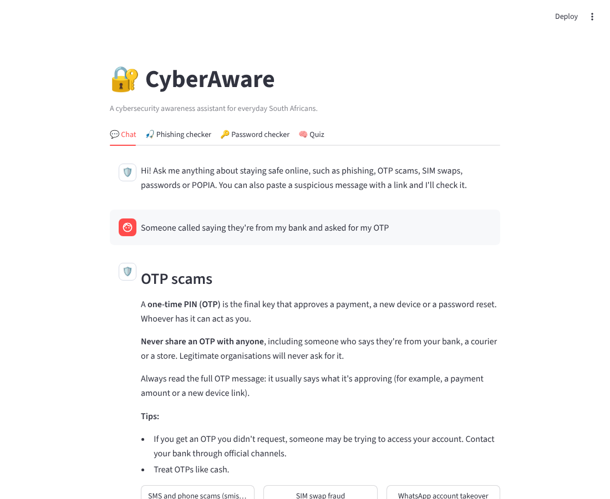
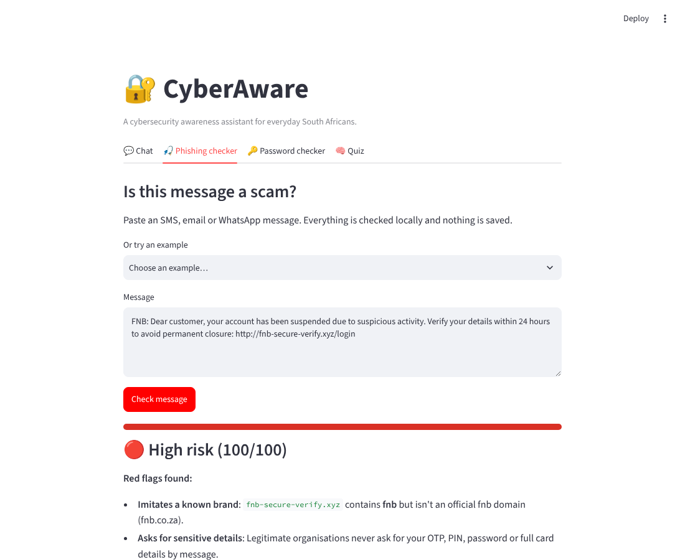
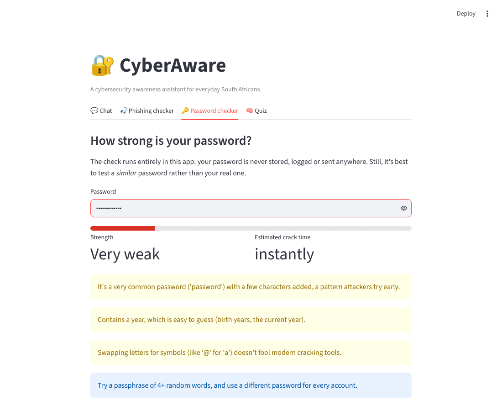

# 🔐 CyberAware: Cybersecurity Awareness Chatbot

[](https://github.com/Bothokakula/cybersecurity-awareness-chatbot/actions/workflows/ci.yml)


[](https://cyberaware-za.streamlit.app)

CyberAware is a Python chatbot that teaches everyday South Africans how to stay safe online. It answers questions about phishing, OTP and SIM-swap fraud, passwords, POPIA and more, and includes tools that **explain** why a message or password is risky, not just whether it is.

> **Why I built it:** South Africans are heavily targeted by banking-app, OTP and SIM-swap scams. Most awareness material is long PDFs nobody reads. I wanted something people could just *ask*, with locally relevant examples.


**👉 Try it live: [cyberaware-za.streamlit.app](https://cyberaware-za.streamlit.app)**
## Features

| Feature | What it does |
|---|---|
| 💬 **Chat assistant** | Answers questions on 24 security topics using TF-IDF retrieval. It handles typos and abbreviations ("2fa", "otp"), suggests related topics, and admits when it doesn't know. |
| 🎣 **Phishing checker** | Scores a pasted SMS, email or WhatsApp message from 0 to 100 using 16 explainable rules: brand look-alike domains, shortened links, IP-address links, urgency, threats, and requests for an OTP or PIN. |
| 🔑 **Password checker** | Estimates entropy and crack time, and penalises common passwords, leetspeak (`P@ssw0rd`), keyboard sequences, repeats and years. Runs entirely offline. |
| 🧠 **Quiz** | Ten scenario-based questions with explanations, drawn at random. |
| 🖥️ **Two interfaces** | A Streamlit web app, plus a terminal app (`cyberaware`) that hides password input. |

<table>
  <tr>
    <td></td>
    <td></td>
  </tr>
</table>

## How it works

```
                ┌──────────────────────────┐
 user message → │  ChatEngine.reply()      │
                │                          │
                │  contains a link, or     │──yes──► phishing.analyse_message()
                │  starts with "check:"?   │            rule-based score + reasons
                │          │ no            │
                │          ▼               │
                │  normalise text          │  expand "2fa", "otp", drop filler words
                │          ▼               │
                │  TF-IDF vectors          │  word 1–2-grams (meaning)
                │  (FeatureUnion)          │  + char 3–5-grams (typo tolerance)
                │          ▼               │
                │  cosine similarity vs    │
                │  212 example questions   │
                │          ▼               │
                │  score ≥ 0.35 → answer   │
                │  otherwise   → fallback  │  suggests the closest topics
                └──────────────────────────┘
```

**Design decisions**

- **Retrieval over a generative LLM.** For safety advice, answers need to be accurate and reviewable. Every answer the bot can give is written in [`knowledge_base.json`](src/cyberaware/data/knowledge_base.json), so it can't invent advice. It also runs offline, for free, with no API keys.
- **Explainable rules for phishing.** Each red flag comes with a plain-language reason, because the goal is to *teach* people to spot scams. A black-box "87% phishing" score wouldn't do that.
- **Privacy by design.** No message or password is stored, logged or sent anywhere. In line with POPIA's spirit, the safest data is data you never collect.
- **Content separate from code.** Topics, quiz questions and the common-password list are data files, so non-developers can extend them. A loader validates the data, rejecting duplicate IDs and broken "related topic" links.

## Getting started

Requires **Python 3.10+**.

```bash
git clone https://github.com/Bothokakula/cybersecurity-awareness-chatbot.git
cd cybersecurity-awareness-chatbot
python -m venv .venv
# Windows: .venv\Scripts\activate    macOS/Linux: source .venv/bin/activate
pip install -e ".[web,dev]"
```

**Web app**

```bash
streamlit run app.py
```

**Terminal app**

```bash
cyberaware          # or: python -m cyberaware
```

```
You: what is a sim swap
Bot: SIM swap fraud
     In SIM swap fraud, a criminal convinces or bribes someone at a cellphone network...
     Related: OTP scams | Multi-factor authentication (2FA/MFA)
```

Terminal commands: `/topics`, `/check`, `/password`, `/quiz`, `/help` and `/quit`.

## Testing

```bash
pytest        # 51 tests
ruff check .  # linting
```

The tests cover intent matching (including typos and off-topic questions), every phishing rule, password edge cases (leetspeak, common-password variants) and knowledge-base integrity. GitHub Actions runs linting and tests on Python 3.10 and 3.12 for every push.

## Project structure

```
├── app.py                         # Streamlit web interface
├── src/cyberaware/
│   ├── engine.py                  # TF-IDF intent matching and routing
│   ├── phishing.py                # Rule-based phishing analyser
│   ├── passwords.py               # Entropy and pattern-based password checker
│   ├── quiz.py                    # Quiz drawing and grading
│   ├── knowledge.py               # Data loading and validation
│   ├── cli.py                     # Terminal interface
│   └── data/
│       ├── knowledge_base.json    # 24 topics, 212 example questions
│       ├── quiz.json
│       └── common_passwords.txt
├── tests/                         # pytest suite
└── .github/workflows/ci.yml       # Lint and test on every push
```

## Limitations and next steps

- The phishing checker is a **heuristic**: it can miss new tricks and occasionally flag legitimate messages. It supports human judgement and doesn't replace it.
- The password checker uses a small common-password list. A production version would check against breach data, for example the Have I Been Pwned k-anonymity API.
- Possible next steps:
  - multilingual answers (isiZulu, Sesotho, Afrikaans)
  - a phishing classifier trained on a labelled SMS dataset, compared against the rule baseline
  - deployment to Streamlit Community Cloud

## Disclaimer

CyberAware provides general awareness information, not professional security or legal advice. If you've lost money to fraud, contact your bank immediately through its official number.

## Author

**Botho Kakula**, final-year BCIS (Application Development) student, IIE Emeris Waterfall (Varsity College)
[GitHub](https://github.com/Bothokakula) · kbotho772@gmail.com

Licensed under the [MIT License](LICENSE).
